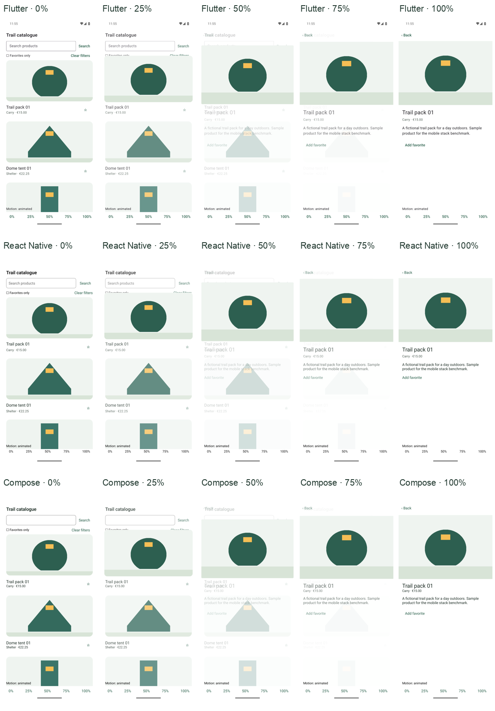

# Mobile Stack Benchmark

What changes when the same mobile experience is built with Flutter, React Native
or native UI? This lab makes that question inspectable through working apps,
a shared visual contract and reports backed by reproducible builds and raw evidence.
It explores the trade-offs in shared code, application size and interface behavior
for a concrete use case.

The first use case is an offline hiking catalogue: search 200 fictional products,
save favorites locally, open a product and return to the same place in the list.
Twenty original illustrations are shared by all apps. Flutter and React Native
cover Android and iOS; the native implementations use Jetpack Compose on Android
and SwiftUI on iOS.

Each implementation has an instant version (**S**) and an animated version (**A**).
A moves the product image into the detail screen over a programmed 400 ms, then
returns to the same card. Comparing S and A shows what this transition adds to
the maintained code and the packaged application.

**Status: the virtual-device milestone is complete.** Four implementations cover
six targets on an Android emulator and an iOS simulator. The report verifies
functionality and image geometry, measures Release build sizes and source counts,
and preserves exploratory Android memory diagnostics. Physical-device fluidity,
startup and memory comparisons have not been performed.

## Reports and use cases

Browse the **[reports and use cases index](docs/reports/README.md)** to find each
published experiment, the scenarios it covers, its evidence and its limitations.
The index currently contains one report:

- **[Offline catalogue and image transition — virtual-device report](https://github.com/FredDevAxes/mobile-stack-benchmark/blob/v0.1.0-virtual-devices/results/REPORT.md)**:
  build sizes, maintained source, functional and visual checks, demonstrations and
  limited runtime diagnostics, preserved at **`v0.1.0-virtual-devices`**.

Use that tag to retrieve the verified evidence and source. The
[local report](results/REPORT.md) is also available when browsing a clone offline.

## Examples from the report

These examples come from `v0.1.0-virtual-devices`. Compare stacks within each
platform; the Android and iOS columns measure different package formats.

### How large is the animated application?

| Implementation | Android Release APK (MiB) | iOS device Release application (MiB) |
| --- | ---: | ---: |
| Flutter | 16.274 | 15.092 |
| React Native | 14.520 | 19.179 |
| Native: Compose / SwiftUI | 1.006 | 0.486 |

MiB means 1,048,576 bytes. Android measures the complete arm64-v8a APK; iOS
measures an unsigned arm64 device `.app` bundle. These are neither store download
sizes nor installed footprints. Native apps rely on system frameworks, while
Flutter and React Native include runtime libraries in their packages. See the
[full S/A tables and build settings](results/REPORT.md#build-sizes).

### How much source does the transition add?

| Coverage of Android and iOS | S application lines | A application lines | Added lines |
| --- | ---: | ---: | ---: |
| Flutter | 486 | 540 | 54 |
| React Native | 423 | 471 | 48 |
| Native: Compose + SwiftUI | 473 | 578 | 105 |

Shared Flutter/React Native source is counted once; native coverage sums Kotlin
and Swift. These are formatted nonblank, noncomment application lines, excluding
tests and generated dependencies. The shared implementations avoid writing the
transition twice. Line counts do not establish development time, quality or
maintenance cost. The [source manifest and method](results/REPORT.md#formatted-maintained-source)
define what is included.

### Does the interface follow the same contract?

The milestone passed 54 functional/visual flows and 30 deterministic transition
stages. The maximum image geometry, corner and landmark error was 0.943 logical
units against a 2-unit tolerance. These checks validate the specified image
transition; they do not measure its actual speed or certify the entire interface.



*The report compares the same image at five fixed progress values. The programmed
400 ms duration is not a measured performance result.*

[Android three-app video](results/visuals/android/comparison.mp4) ·
[iOS three-app video](results/visuals/ios/comparison.mp4) ·
[Functional and visual evidence](results/REPORT.md#functional-and-visual-verification)

Videos illustrate behavior; panels start at recording time and gestures are not
synchronized. They do not establish a performance ranking. Flutter's tested iOS
simulator supports Debug only, so its runtime diagnostics are not ranked against
React Native or SwiftUI Release. The iOS package sizes above use separately compiled
unsigned device Release bundles. The [runtime diagnostics and unavailable metrics](results/REPORT.md#runtime-diagnostics)
explain why this milestone does not identify the fastest or smoothest stack.

## Start here

The complete workflow needs a Mac with Xcode and Android tools. Android-only
builds can run on Linux. No backend or secret is required. Follow the
[step-by-step reproduction guide](docs/REPRODUCE.md) for exact versions,
installation, building, running the apps and collecting evidence.

Once its setup steps are complete, these root commands run all four projects:

```sh
python3 scripts/check_assets.py
python3 scripts/lab.py lint
python3 scripts/lab.py test
python3 scripts/build_matrix.py
```

Build just one variant and target with:

```sh
python3 scripts/lab.py build --stack compose --platform android --variant A
```

S physically excludes the custom animation timer, coordinate measurement and
interpolation. Production builds also exclude inspection controls. Always use
root commands when comparing sizes; [source projection](docs/decisions.md#sa-source-separation)
is part of the build. Archives are separated under `.work/artifacts/`.

## Applications and evidence

| Project | Targets | App guide |
| --- | --- | --- |
| Flutter / Dart | Android and iOS | [Flutter](apps/flutter/README.md) |
| React Native / TypeScript, Hermes, Fabric | Android and iOS | [React Native](apps/react-native/README.md) |
| Kotlin / Jetpack Compose | Android | [Compose](apps/compose/README.md) |
| Swift / SwiftUI | iOS | [SwiftUI](apps/swift/README.md) |

This is a monorepo because all apps implement one contract. A small Python runner
coordinates each ecosystem's own tools; it does not replace Gradle, Flutter,
Node or Swift. `shared/` holds canonical data/artwork, `verification/` the common
UI flows, `scripts/` the orchestration/collectors, and `results/` retained evidence.
The unrelated smoke-app pilot stays local and is excluded from the comparison.

- [Protocol and visual reference](docs/protocol.md)
- [Implementation and dependency decisions](docs/decisions.md)
- [Pinned toolchain](toolchain.json)
- [Build/source identities](results/builds.json), [code manifest](results/code.json),
  [environment](results/environment.json), [source equivalence](results/source-equivalence.json),
  [retained driver attempts](results/trials.json)
- [CI workflow](.github/workflows/checks.yml) and [actual runs](https://github.com/FredDevAxes/mobile-stack-benchmark/actions)

## Checks and scope

Dart format/analyze, ESLint/TypeScript/Prettier, ktlint/Android lint,
swift-format and Ruff cover the maintained projects/tooling. Unit suites verify
data, filtering and favorite logic; local Maestro flows verify installed S/A
apps, scroll state, persistence, back and reduced-motion handling. CI runs
linters, tests, secret scanning and supported compilation on every push and PR.
Earlier CI/driver failures remain part of the history; the milestone records the
successful checks instead of claiming every historical attempt passed.

Build size and line counts describe this small implementation. They do not measure
code quality, delivery cost or every stack's performance. The current locked RN
tooling tree still has inherited audit advisories; details and practical limits
are in the [report](results/REPORT.md#limits-and-dependencies). This is an
inspectable lab, not a production security or accessibility certification.

All original code and artwork across the monorepo use the [MIT license](LICENSE).
Frameworks, dependencies and adapted templates retain their
[third-party licenses and credits](THIRD_PARTY.md).
