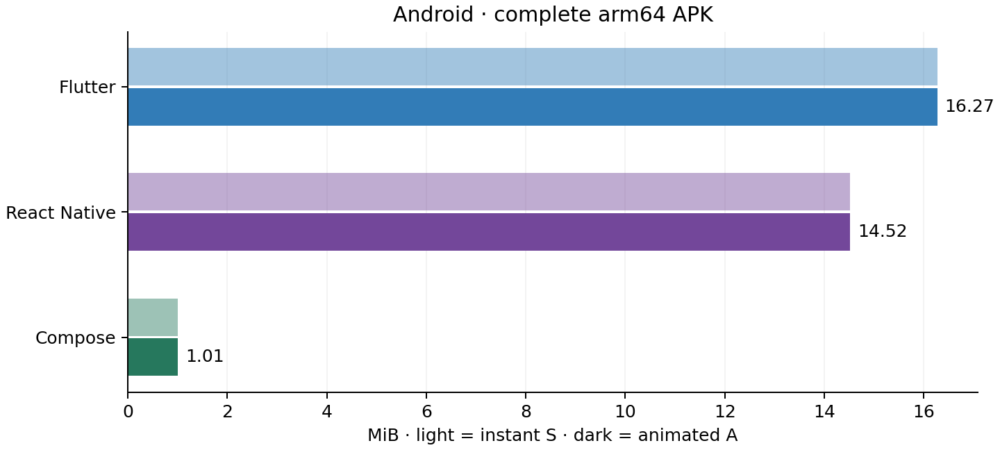
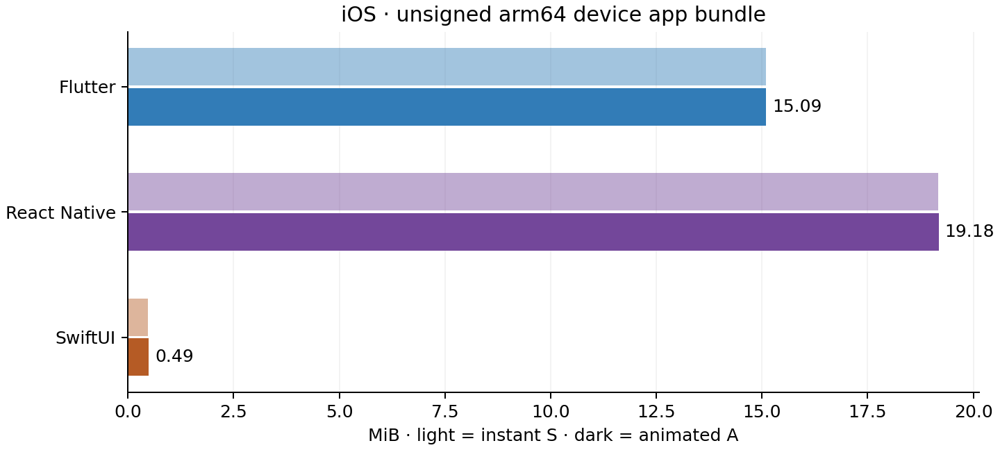
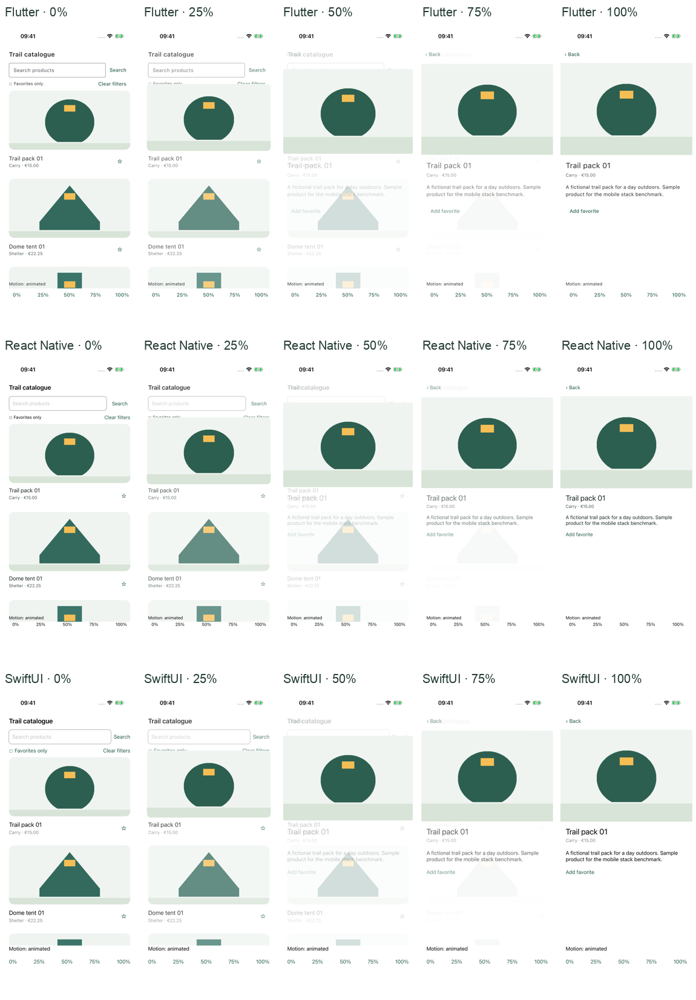

# Results — virtual-device milestone

Milestone: `v0.1.0-virtual-devices`. Clean application source revisions are retained per stack in [builds.json](builds.json); each stack uses the same revision for all S/A artifacts and checks.

This is one offline catalogue with 200 fictional products and 20 shared original illustrations. It measures these implementations and build settings. It does not identify a universally best mobile stack.

## Build sizes

Android numbers are complete arm64-v8a Release APK file bytes. iOS numbers are unsigned device arm64 Release `.app` logical regular-file bytes; duplicate symlink targets and external symbols are excluded. MiB means 1,048,576 bytes. No store download, installed footprint, AAB or IPA is measured.

### ANDROID

| Stack | S bytes | A bytes | A − S bytes | S MiB | A MiB |
| --- | ---: | ---: | ---: | ---: | ---: |
| Flutter | 17,064,507 | 17,064,507 | +0 | 16.274 | 16.274 |
| React Native | 15,224,143 | 15,225,535 | +1,392 | 14.519 | 14.520 |
| Compose | 1,055,178 | 1,055,178 | +0 | 1.006 | 1.006 |

### IOS

| Stack | S bytes | A bytes | A − S bytes | S MiB | A MiB |
| --- | ---: | ---: | ---: | ---: | ---: |
| Flutter | 15,825,247 | 15,825,247 | +0 | 15.092 | 15.092 |
| React Native | 20,108,756 | 20,110,593 | +1,837 | 19.177 | 19.179 |
| SwiftUI | 494,403 | 509,963 | +15,560 | 0.471 | 0.486 |

Evidence: [all artifact identities, commands, settings and per-file source hashes](builds.json). All Android builds shrink/minify release code and resources; Flutter also tree-shakes Dart/icons. Flutter uses a split APK to exclude foreign-ABI plugin libraries. RN bundles Hermes bytecode and uses its release defaults; SwiftUI uses `swiftc -O` and `strip -S` against system frameworks. These ecosystem settings are disclosed rather than assumed identical.

The A − S difference includes compiler optimization and packaging effects. A small or negative delta does not mean the animation has no runtime cost. Framework libraries used by the catalogue remain in S.

## Formatted maintained source

| Stack | Variant | UI/navigation | Model, loading, persistence/lifecycle | Navigation module | Platform bootstrap | Application total | Tests |
| --- | --- | ---: | ---: | ---: | ---: | ---: | ---: |
| Flutter | S | 386 | 73 | 10 | 17 | 486 | 42 |
| React Native | S | 288 | 53 | 11 | 71 | 423 | 16 |
| Compose | S | 230 | 37 | 12 | 0 | 279 | 16 |
| SwiftUI | S | 152 | 33 | 9 | 0 | 194 | 18 |
| Flutter | A | 422 | 73 | 28 | 17 | 540 | 42 |
| React Native | A | 318 | 53 | 29 | 71 | 471 | 16 |
| Compose | A | 266 | 37 | 21 | 0 | 324 | 16 |
| SwiftUI | A | 176 | 33 | 45 | 0 | 254 | 18 |

| Coverage | S lines | A lines | A − S |
| --- | ---: | ---: | ---: |
| Flutter, Android + iOS | 486 | 540 | +54 |
| React Native, Android + iOS | 423 | 471 | +48 |
| Native, Compose + SwiftUI | 473 | 578 | +105 |

Shared Flutter/RN screens are counted once. Native coverage is the sum of Kotlin and Swift. cloc 2.10 counts nonblank noncomment lines after language-specific formatting. The file manifest, extracted handler ranges, hashes, separate tests, inspection controls, configuration and shared tooling are in [code.json](code.json). Lifecycle code in the extracted persistence handlers is included; UI bindings stay with UI. Configuration files unrecognized by cloc are explicitly listed with zero recognized lines, not counted as application source.

These counts describe the maintained implementation, including adapted bootstrap files. They do not measure quality, delivery effort, maintainability or developer productivity. Work was implemented sequentially with AI assistance; no reliable time diary was collected.

## Functional and visual verification

The installed S/A variants run the same catalogue search, empty-state, favorites/persistence and return-to-list flow. Separate scroll flows exercise a lower item and retain the list position. Repeated card input and button back are exercised on iOS; Android additionally exercises system back. Inspection builds expose the five fixed timeline stages and the actual reduced-motion flag; those controls are excluded from size artifacts and diagnostics.

See [per-target verification records](verification/), [all retained driver attempts, including failures](trials.json), [geometry checks](geometry.json), [environment](environment.json) and [protocol](../docs/protocol.md). Driver execution time is not application latency. The repeated-input driver cannot prove the exact timestamp of an input within a 400 ms transition; the input guards and queued-back implementation remain available for review.

Historical failed attempts include incorrect inaccessible title selectors, clipped tap targets, an unexplained Flutter scroll/capture failure that passed on retry, an unchanged SwiftUI first tap, a hidden RN Android favorite node selected by the driver, an interrupted simulator handoff and a UI-driver startup timeout. The detail favorite is now anchored below its unique description. The stale Android pilot signing mismatch is retained in the installation recovery record. They are retained rather than treated as zero or silently discarded. Latest milestone pass reports are separate from earlier dirty-source exploratory attempts.

| Target | S functional | A functional | Five timeline stages | Reduced motion | Runtime mode |
| --- | --- | --- | --- | --- | --- |
| Flutter · ANDROID | PASS | PASS | PASS | PASS | Release/optimized |
| React Native · ANDROID | PASS | PASS | PASS | PASS | Release/optimized |
| Compose · ANDROID | PASS | PASS | PASS | PASS | Release/optimized |
| Flutter · IOS | PASS | PASS | PASS | PASS | Debug |
| React Native · IOS | PASS | PASS | PASS | PASS | Release/optimized |
| SwiftUI · IOS | PASS | PASS | PASS | PASS | Release/optimized |

[Acceptance gate](acceptance.json): 54 successful flows and 30 deterministic stages. Maximum geometry/corner/landmark error: 0.943 logical units against the 2-unit tolerance. An original amber landmark verifies centered uniform cover crop. Text antialiasing and actual animation speed are outside this pixel check.

All 12 pairs retain identical catalogue content pixels after excluding the outer 16 logical units reserved for the scrollbar. Raw differences and their bounds are retained in [scroll.json](scroll.json); the small differences lie on that scrollbar margin. These are same-device comparisons, not cross-platform text matching.

[Fresh public-clone reproduction](reproduction.json) executed locked dependency installation, all project linters/tests and a SwiftUI S build. The complete 18-output build matrix was executed on the reference working tree; hosted [CI](ci.json) independently compiles all supported targets. Those scopes are kept separate.

[Three-app android demonstration](visuals/android/comparison.mp4). Individual source recordings remain in each stack directory. Demonstration recordings are normalized to 30 fps, aligned at recording start, without a speed change; gesture/dump delays differ, so the panels are not a synchronized performance experiment.

[Three-app ios demonstration](visuals/ios/comparison.mp4). Individual source recordings remain in each stack directory. Demonstration recordings are normalized to 30 fps, aligned at recording start, without a speed change; gesture/dump delays differ, so the panels are not a synchronized performance experiment.

## Runtime diagnostics

Android guest-process TOTAL PSS from `dumpsys meminfo`, KiB. Each series runs the first cycle separately, 5 warmups and 30 recorded cycles, with one second stable rest and alternating order. The table summarizes the three after-series snapshots, not a 30-frame distribution. Host emulator/GPU allocations and physical-device memory are outside coverage.

| Stack | Variant | Series | Median after KiB | Min–max after KiB | Median before KiB |
| --- | --- | ---: | ---: | --- | ---: |
| Flutter | S | 3 | 82,992 | 59,507–83,398 | 87,479 |
| Flutter | A | 3 | 84,672 | 84,310–86,363 | 88,473 |
| React Native | S | 3 | 109,049 | 107,860–116,839 | 94,629 |
| React Native | A | 3 | 97,463 | 96,491–103,880 | 108,487 |
| Compose | S | 3 | 58,483 | 57,733–58,601 | 46,176 |
| Compose | A | 3 | 43,722 | 40,916–45,457 | 45,470 |

Per-series snapshots:

| Stack | Variant | Series | Before KiB | After KiB | After − before KiB |
| --- | --- | ---: | ---: | ---: | ---: |
| Flutter | S | 1 | 64,925 | 59,507 | -5,418 |
| Flutter | A | 1 | 88,410 | 84,672 | -3,738 |
| React Native | S | 1 | 94,165 | 107,860 | +13,695 |
| React Native | A | 1 | 107,468 | 96,491 | -10,977 |
| Compose | S | 1 | 45,271 | 57,733 | +12,462 |
| Compose | A | 1 | 44,544 | 45,457 | +913 |
| React Native | A | 2 | 108,487 | 97,463 | -11,024 |
| React Native | S | 2 | 94,629 | 109,049 | +14,420 |
| Compose | A | 2 | 45,470 | 40,916 | -4,554 |
| Compose | S | 2 | 46,176 | 58,483 | +12,307 |
| Flutter | A | 2 | 88,503 | 84,310 | -4,193 |
| Flutter | S | 2 | 87,479 | 82,992 | -4,487 |
| Compose | S | 3 | 46,236 | 58,601 | +12,365 |
| Compose | A | 3 | 45,625 | 43,722 | -1,903 |
| Flutter | S | 3 | 88,402 | 83,398 | -5,004 |
| Flutter | A | 3 | 88,473 | 86,363 | -2,110 |
| React Native | S | 3 | 95,310 | 116,839 | +21,529 |
| React Native | A | 3 | 114,436 | 103,880 | -10,556 |

[Samples and raw meminfo/gfxinfo traces](diagnostics/android/). The cycle count is the scripted input count; the driver checks catalogue text after the first and last cycle, without independently validating every intermediate foreground state. Three snapshots per variant do not establish significance or a memory leak. Android gfxinfo has different render coverage across stacks, so no common frame-time/jank ranking is published.

| Metric | Status and reason |
| --- | --- |
| Input-to-first-change latency | Unavailable: no validated common timestamp source |
| Frame times / jank | Unavailable as a common comparison: Flutter render coverage differs from native HWUI |
| Observed animation duration | Not measured; 400 ms is the programmed contract |
| iOS process memory / CPU | Not ranked: Flutter simulator Debug differs from RN/SwiftUI Release, and host RSS is not iPhone memory |
| D1 scroll performance | Functional scroll retention verified; performance sequence not validated |
| D2 usable startup | Unavailable: process launch and usable catalogue markers not jointly validated |

## Limits and dependencies

The devices are virtual, with one reference size per platform, default text size and light portrait rendering. System fonts differ, and safe-area origins are measured separately. Twenty reused illustrations do not represent 200 unique photographs, network loading, a complex business app, accessibility certification or store distribution. Device iOS bundles compile but were not installed on physical phones; no distribution signing or IPA export is claimed.

Pinned versions and locks are in [toolchain.json](../toolchain.json), pubspec.lock, package-lock.json, Podfile.lock, Gemfile.lock, Gradle locks/wrapper hashes and requirements.lock. Flutter native dependency declarations come from its pinned SDK/plugins; the Gradle engine plugin is not independently reimplemented. Hosted runner OS images can change. Reproduction means the documented checks/builds work with declared inputs, not guaranteed byte-for-byte signing, compiler or archive timestamps.

The retained [RN npm audit](dependency-audit.json) reports 53 inherited tooling advisories (5 moderate, 48 high), from the locked dependency tree, principally braces/sprintf-js chains. Compatible updates were applied; the suggested framework downgrade was not accepted. This lab is not a production security certification. Preserve upstream licenses and review advisories before reuse. No credentials or private signing material are tracked.

[Exploratory Node 25.6 size records](history/node25-exploratory-builds.json) are retained separately. A generated Xcode path overrode the declared Node version; the final cohort was rebuilt with Node 24.13 selected and recorded. The final Flutter cohort additionally fixes the distinct iOS Reduce Motion flag discovered by the OS probe. The final SwiftUI cohort blocks hit testing without disabled-button dimming, so the background catalogue retains its colors before the backdrop fade. RN and Compose projections are unchanged. The final table uses only clean sources and the declared Node runtime.

The narrower conclusion is that this catalogue can be inspected across four implementations with source-isolated animation variants. Use the actual within-platform size deltas and maintained-source counts; do not turn them into a global score or a claim about every project.
